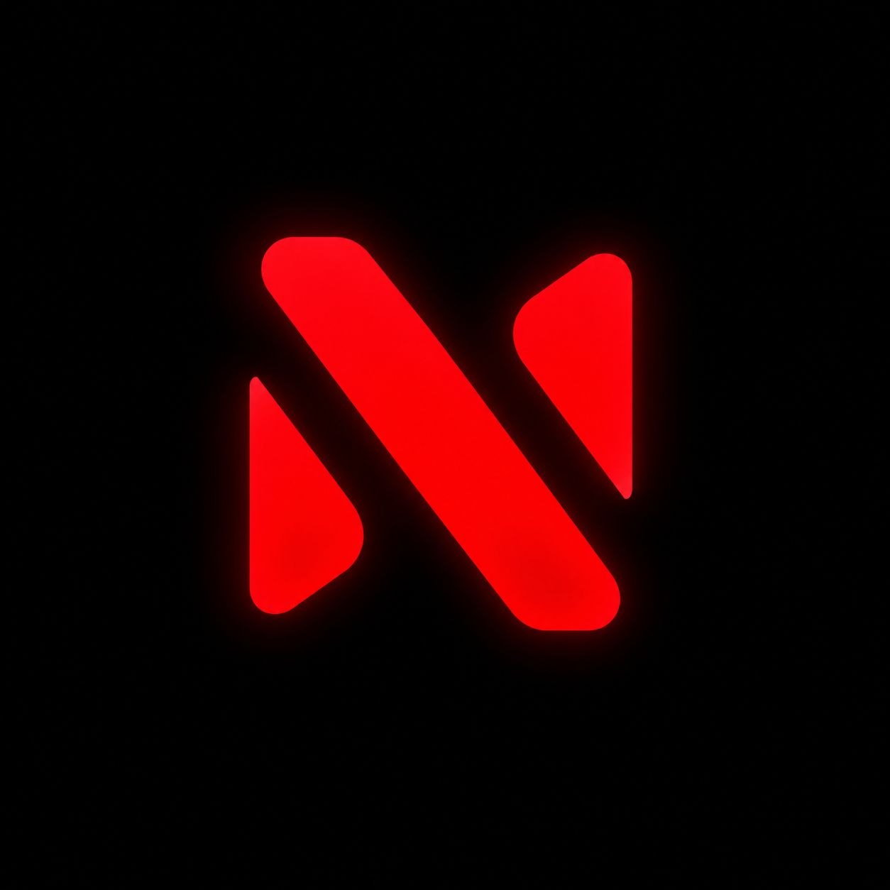

  
  <h1>Noble Launcher</h1>
  
<b>Современный, быстрый и безопасный лаунчер для Minecraft</b>

  
  
  

---

## 📖 О проекте

**Noble Launcher** — это полностью переработанный лаунчер для Minecraft, созданный для комфортной, быстрой и безопасной игры. 

В версии **2.9.0** мы полностью отказались от платформы Electron и переписали проект на **C++ с использованием Qt Quick/QML**. Это позволило снизить потребление оперативной памяти до **≤100 МБ**, ускорить запуск и сделать интерфейс по-настоящему нативным и отзывчивым.

Мы не поддерживаем регистрацию через Microsoft. Наш лаунчер работает с аккаунтами **Ely.by** и **Offline (локальными)**. Мы ценим вашу конфиденциальность: лаунчер работает полностью офлайн, у нас нет серверов для сбора статистики или ваших данных.

## ✨ Ключевые возможности

*   **Умный запуск и Java:** Лаунчер автоматически сканирует весь ПК в поисках подходящей Java, проверяет её разрядность и версию, подбирает нужные JVM-флаги. Ошибки вроде `Could not create the Java Virtual Machine` исключены благодаря безопасному планированию памяти (Heap).
*   **3D-Скины:** Интерактивный предпросмотр скина. При авторизации через Ely.by лаунчер автоматически подгружает ваш актуальный скин (с защитой от ошибок 404) и отображает его на 3D-модели.
*   **Оптимизация игры (Windows):** Безопасная и обратимая настройка системы под Minecraft (игровой режим, высокий приоритет, настройки GPU) с ведением логов и кнопкой отката.
*   **10 сборок от Noble:** Встроенные сборки-оптимизации (для NVIDIA, AMD, Intel, PvP, стриминга и слабых ПК), которые работают через легкие zip-манифесты, не занимая лишнего места на диске.
*   **Менеджер модов:** Поддержка Modrinth и ручного сканирования. Очередь загрузок с этапами проверки (Resolve → Download → Verify → Install) и отображением прогресса. Никаких зависаний на 90%.
*   **Формат сборок `.Nb`:** Удобный экспорт и импорт ваших сборок со всеми настройками, модами и ресурспаками в один файл.
*   **Кастомизация:** Свои фоны с настройкой размытия, затемнения и насыщенности. Выбор шрифта (Minecraft, системный или свой). 
*   **Удобная консоль:** Листаемый вывод игры, поиск, копирование и сохранение логов. Если консоль отключена в настройках, она не нагружает систему.
*   **Достижения и профиль:** Система очков, уровней и достижений за игру. Отслеживание времени в игре.
*   **Steam Friends (Beta):** Возможность играть с друзьями через Steam (на базе e4steam) без проброса портов.

## 🚀 Как начать играть?

1.  Скачайте последний установщик `NobleLauncherSetup-2.9.0.exe` напрямую по [этой ссылке](https://github.com/DevvTorn/NobleLauncher/releases/download/Version-2/NobleLauncherSetup-2.9.0.exe) или с нашего [сайта](https://noblelauncher.ru/).
2.  Установите лаунчер и запустите его.
3.  Авторизуйтесь через **Ely.by** или создайте **Offline**-аккаунт.
4.  Выберите готовую сборку (например, одну из 10 оптимизаций) или создайте свою, настройте память и нажмите **«Запуск»**.

## 🛠 Технологический стек

*   **Язык:** C++ (Строгая типизация, высокая производительность).
*   **UI:** Qt 6 / Qt Quick (QML).
*   **Сборка:** CMake, MSVC.
*   **Память:** Оптимизирована до ≤100 МБ (вместо 300+ МБ на Electron).
*   **Платформа:** Windows (приоритет), с потенциалом кроссплатформенности.

## 📜 Правовая информация и лицензия

> ⚠️ **ВНИМАНИЕ: ИСХОДНЫЙ КОД ДОСТУПЕН ТОЛЬКО ДЛЯ ОЗНАКОМЛЕНИЯ (SOURCE AVAILABLE).**

**Copyright (c) 2025 Ainur (DevvTorn). All rights reserved.**

Данный репозиторий НЕ является Open Source в понимании OSI. Мы выложили исходный код, чтобы вы могли убедиться в его безопасности и чистоте. 

*   **Вам РАЗРЕШЕНО:** Просматривать код, изучать архитектуру, проверять на наличие вредоносного ПО.
*   **Вам ЗАПРЕЩЕНО (без письменного разрешения авторов):** 
    *   Создавать форки (Fork) с целью модификации и публикации.
    *   Копировать, изменять или распространять любые части исходного кода.
    *   Использовать код в своих проектах.
    *   Собирать собственные версии (бинарники) на основе этого кода.

*Лаунчер полностью ваш и офлайн. У нас нет серверов, и мы не храним ваши данные. Так что бояться не о чем. Любой может проверить нас, изучив этот код.*

## ⏳ История проекта

*   **Декабрь 2025:** Зародилась идея лаунчера под названием HardLauncher.
*   **Май 2026:** Фокус сместился на разработку собственного мессенджера Noble.
*   **Середина лета 2026:** Проект временно закрылся.
*   **Начало сентября 2026:** Восстановление кода, смена названия на **Noble Launcher**, запуск сайта и релиз. 

Сейчас лаунчером пользуется около **300 человек**, а на сайт ежедневно заходит около **100**. Мы искренне благодарны вам за отзывчивость и поддержку!

## 👨‍💻 Команда

*   **DevvTorn (Ainur)** — Основатель / Разработчик
*   **Volenvi** — Разработчик / Дизайнер

## 🔗 Полезные ссылки

*   🌐 **Наш сайт:** [noblelauncher.ru](https://noblelauncher.ru/)
*   ✈️ **Telegram (обновления):** [t.me/noblelauncher](https://t.me/noblelauncher)
*   💻 **GitHub:** [DevvTorn/NobleLauncher](https://github.com/DevvTorn/NobleLauncher)

---

  <i>Сделано с любовью к Minecraft и оптимизации.</i>

